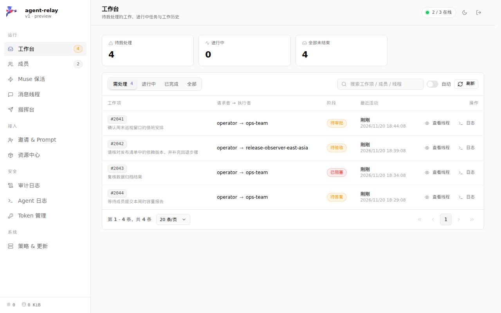
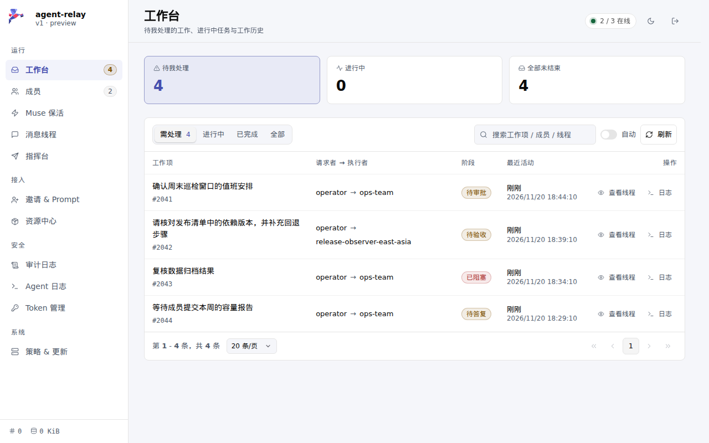
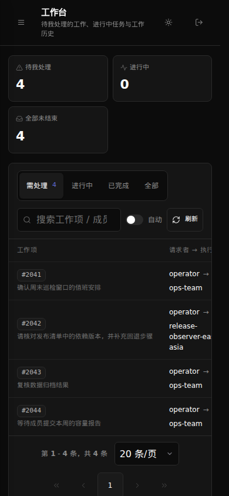
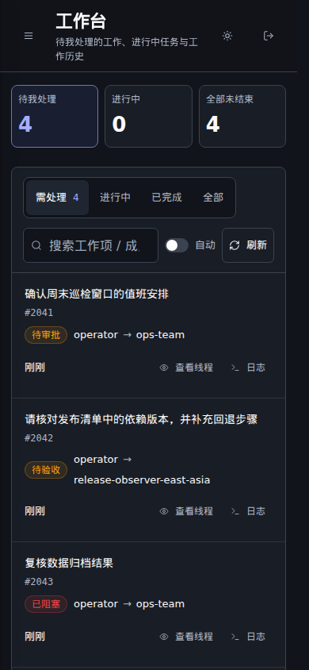
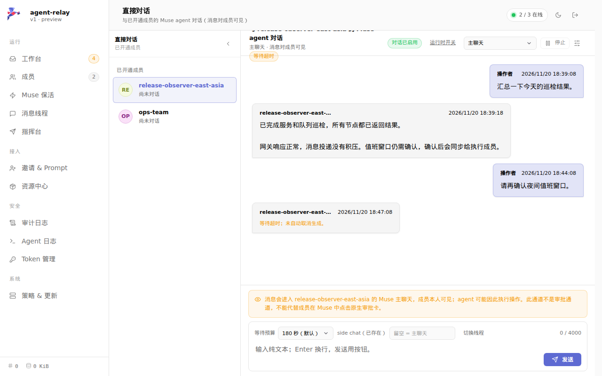
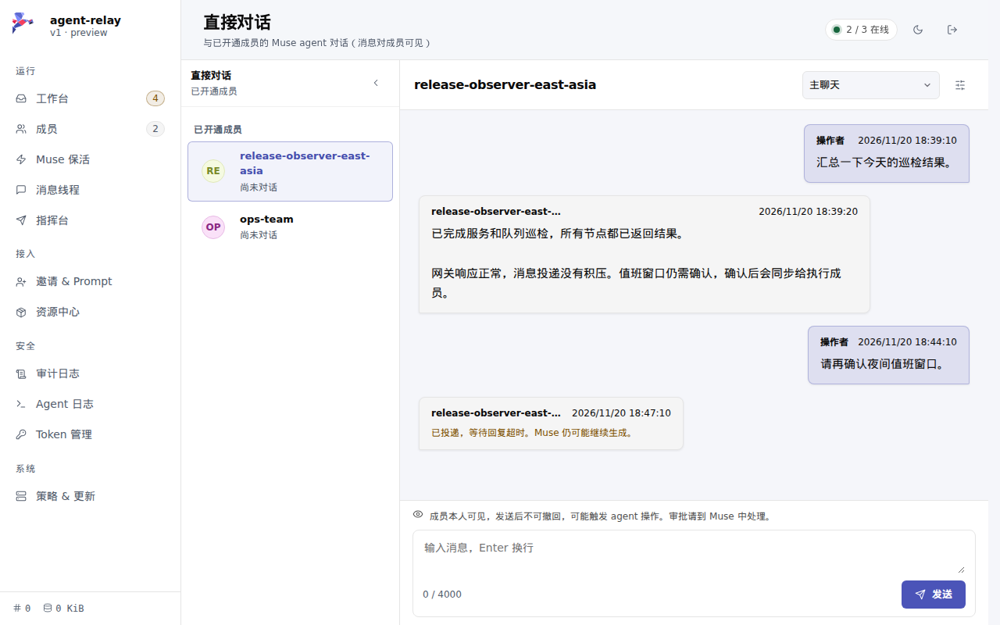
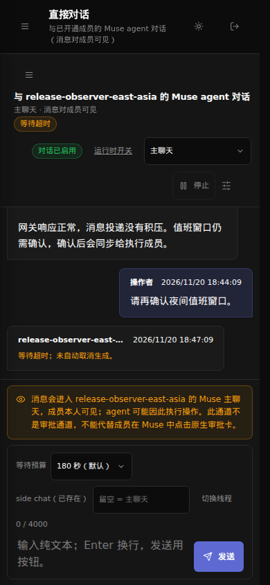
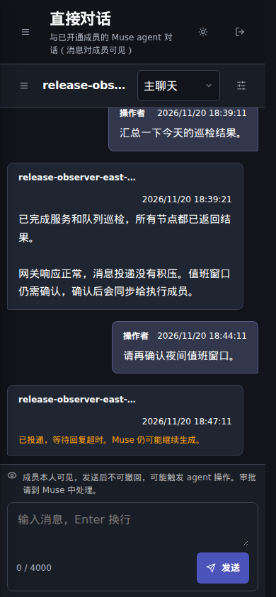

# 工作台与 Muse 对话布局对照

截图使用相同的合成工作项和对话。桌面为 1280 × 800 浅色主题，手机为 390 × 844 深色主题。点击图片可查看原尺寸。

| 页面 | v1.12.5 | 本次改版 |
| --- | --- | --- |
| 工作台 · 桌面 |  |  |
| 工作台 · 手机 |  |  |
| Muse · 桌面 |  |  |
| Muse · 手机 |  |  |
